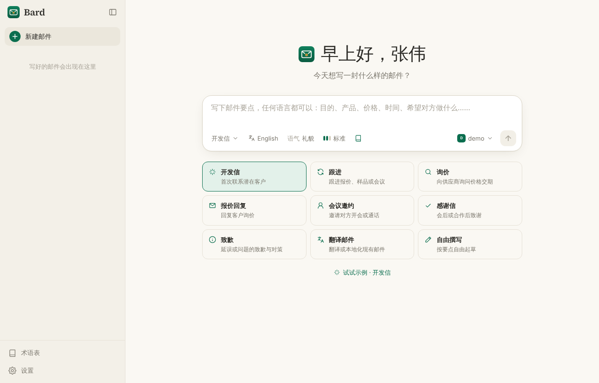
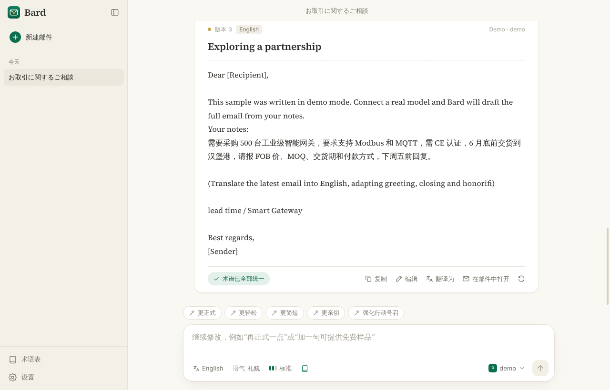
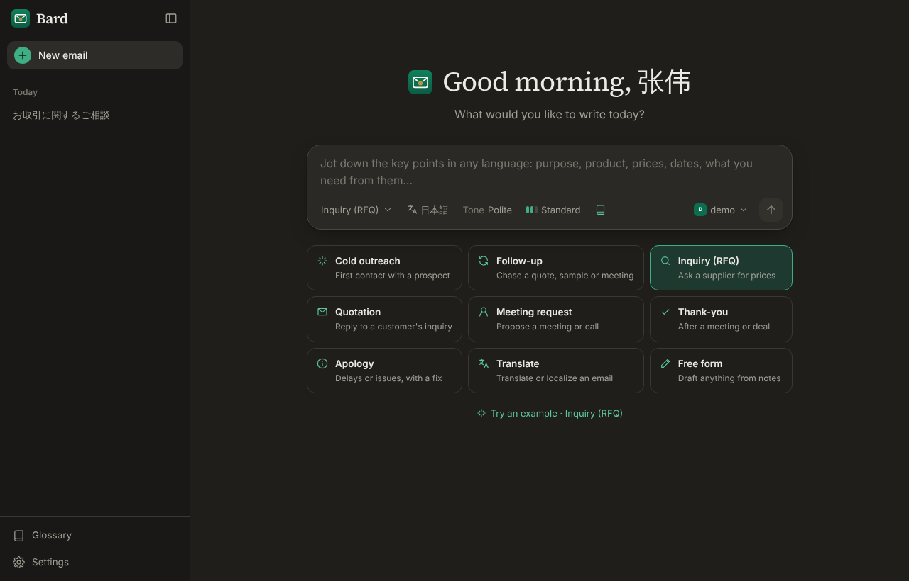
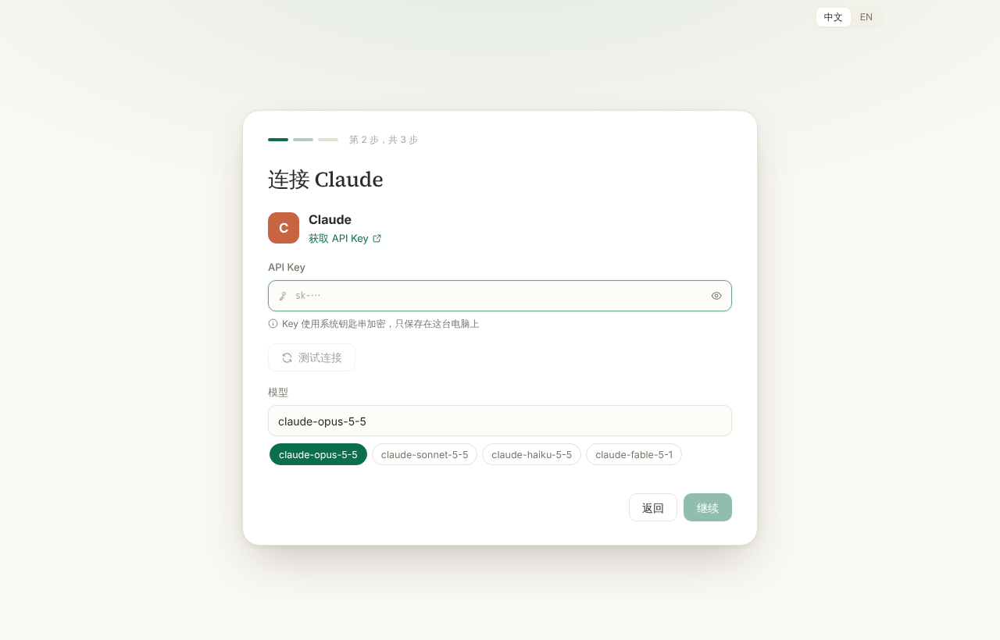
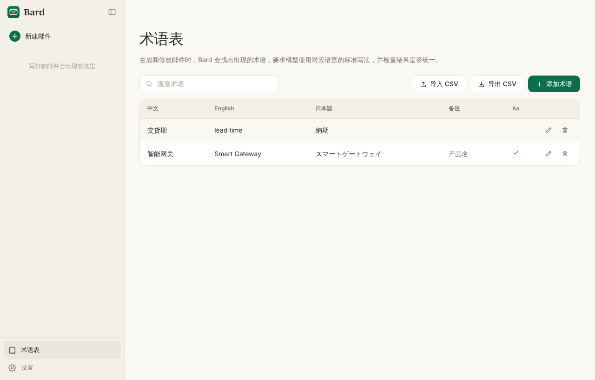

<p align="center"></p>

<h1 align="center">Bard</h1>

<p align="center">多语言商务邮件助手 · 中文 / English / 日本語<br>桌面软件，支持 macOS、Windows、Linux</p>



## 功能

- **对话式写邮件**：写下要点（任何语言都可以），Bard 生成完整邮件。之后可以直接说“再正式一点”“加一句可提供免费样品”，也可以点快捷按钮（更正式、更简短、强化行动号召……）。每次修改都保留为一个新版本。
- **9 种场景模板**：开发信、跟进、询价、报价回复、会议邀约、感谢信、致歉、翻译邮件、自由撰写。
- **语气与正式程度**：6 种语气、3 档正式程度，并按每种语言的商务习惯来写，例如日语的敬語、中文的“此致 敬礼”、英文的 Dear / Hi。
- **翻译与本地化**：点一下就能把邮件翻成另外两种语言，可选“地道本地化”或“忠实直译”。
- **术语表**：维护产品名和专业术语的三语对照。Bard 会自动找出邮件中出现的术语，要求模型使用规定写法，并在结果下方标出没有统一的术语。支持 CSV 导入和导出（示例见 [`examples/glossary-sample.csv`](examples/glossary-sample.csv)）。
- **自带 API Key，支持多家模型服务**：

  | 服务商 | 接入方式 |
  |---|---|
  | Claude（Anthropic） | 官方 SDK |
  | OpenAI | 官方 SDK |
  | Google Gemini | 官方 SDK |
  | DeepSeek、通义千问、Kimi、智谱 GLM | OpenAI 兼容接口 |
  | 自定义 | 任何 OpenAI 兼容接口，如 Ollama 本地模型、中转服务 |

  可以添加多个服务，随时在输入框右下角切换。API Key 用系统钥匙串加密保存（macOS 钥匙串、Windows DPAPI、Linux libsecret），只保存在本机。
- **中英双语界面**，深色和浅色主题（可跟随系统）。
- **数据全部保存在本机**的 SQLite 数据库中，包括邮件记录、术语表和设置。

| 对话式修改 | 深色模式 · 英文界面 |
|---|---|
|  |  |

| 首次启动：连接模型 | 术语表 |
|---|---|
|  |  |

## 安装

在 GitHub 仓库的 **Actions → Release** 页面点 **Run workflow**，会自动打包三个平台的安装包：

| 平台 | 安装包 |
|---|---|
| macOS（Apple 芯片和 Intel） | `Bard-x.y.z-mac-arm64.dmg` / `Bard-x.y.z-mac-x64.dmg` |
| Windows | `Bard-x.y.z-win-x64.exe` |
| Linux | `Bard-x.y.z-linux-x86_64.AppImage` / `.deb` |

运行时在 **version** 一栏填上版本号（如 `v1.0.1`），或者推送同名标签，打包完会自动创建 GitHub Release，并附上全部安装包。

> 安装包目前没有代码签名，第一次打开时：
> - **macOS**：在“访达”里右键点击 Bard →“打开”；或者在“系统设置 → 隐私与安全性”里点“仍要打开”。
> - **Windows**：SmartScreen 提示时，点“更多信息”→“仍要运行”。
>
> 要去掉这些提示，需要在 CI 中配置签名证书（`CSC_LINK`、`CSC_KEY_PASSWORD`，macOS 公证还需要 `APPLE_ID` 等）。

## 开发

需要 Node.js 22.13 或更高版本。

```bash
npm install
npm run dev          # 启动开发版（支持热更新）
npm test             # 单元测试：提示词、术语表、对话流程、各服务商接口
npm run typecheck
npm run dist         # 为当前系统打包；也可用 dist:mac / dist:win / dist:linux
```

设置 `BARD_MOCK=1` 后，服务商列表里会多出一个离线的“Demo”服务，不需要 API Key 就能体验完整流程。

### 项目结构

```
src/
  main/                 Electron 主进程
    providers/          各服务商适配（Claude / OpenAI 兼容 / Gemini）与预设
    prompts.ts          场景、语气、正式程度模板和系统提示词
    chat.ts             对话流程：历史记录、术语匹配、流式输出
    glossary.ts         术语匹配、一致性检查、CSV
    db.ts               SQLite：设置、服务商（Key 加密）、对话、术语表
    ipc.ts              主进程与界面之间的通信接口
  preload/              安全地把接口暴露给界面（window.bard）
  renderer/             React 界面
    src/views/          首页、对话、术语表、设置、首次启动引导
    src/components/     输入框、邮件卡片、菜单、服务商表单……
    src/i18n.ts         中英文界面文案
  shared/               主进程和界面共用的类型
build/                  应用图标
.github/workflows/      CI 测试与三平台打包
```

### 使用 Claude 时

默认模型是 `claude-opus-5-5`。对支持的模型，Bard 会把 effort 设为 `medium`，并开启服务端拒答回退（`fallbacks: "default"`）：如果模型的安全分类器拒绝了请求，API 会自动换用推荐的备用模型重试。
